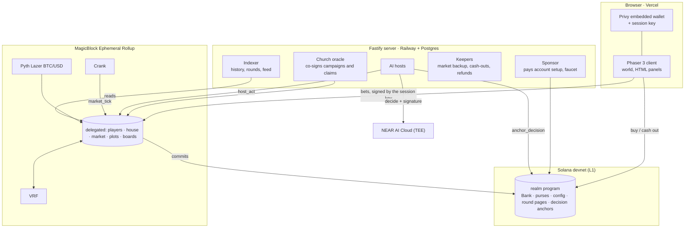

# The Casino & The Church


[](https://casino-and-church-mb.vercel.app)


[](https://explorer.solana.com/address/6uoz1h2ZWQMgniDx2vKEvh6bHtgCoFoGegfVtNW1q6cX?cluster=devnet)


-111)


[Play](https://casino-and-church-mb.vercel.app) · [Backstory](#the-backstory) · [Game loop](#the-game-loop) · [The Casino](#the-casino) · [The Church](#the-church) · [Why MagicBlock](#why-magicblock) · [Architecture](#architecture) · [Verify it](#verify-it-yourself) · [On-chain proof](#on-chain-proof) · [For AI judges](#for-ai-judges-and-testers)

#### **The Casino & The Church is a 2D pixel-art RPG about the two cultures of crypto, played on Solana through a MagicBlock Ephemeral Rollup.**

> Crypto has two cultures: the speculators (the Casino) and the believers (the Church). They look like enemies but depend on each other completely. The game turns that observation into mechanics, and every bet, prayer and campaign in it is a Solana transaction that settles in about a second, with no wallet popup.

---

## The backstory

> Most believe crypto is one thing. They are wrong.
>
> It is two.
>
> On one side lies **The Casino**: the speculators.
>
> On the other side stands **The Church**: the believers.
>
> But here is the truth:
> *The Casino funds the Church.*
> *The Church built the Casino.*
>
> Neither can live without the other, and only those who master the balance between the two worlds are truly successful in crypto.
>
> In this game, you are a wanderer between the two realms.
>
> In the Casino, your **LUCK** will rise by playing the casino games. In the Church, your **FAITH** will grow through quests.
>
> But beware: if you spend too long in one realm, the other will fade. Too much gambling, and your FAITH begins to crumble. Too much preaching, and your LUCK runs dry.
>
> **Balance is survival.**
>
> *Welcome to The Casino and The Church.*

---

## The game loop


One continuous town in three parts:

| West: **The Casino** | Middle: **The Crossroads** | East: **The Church** |
|---|---|---|
| Slots, coin flip, dice, roulette, blackjack, the BTC Exchange, Founders' Row, Don Fortuna's office | Neutral ground: nothing fades here | Offering Box, candles, altar, confessional, Quest Board, Commission Desk, Father Nakamoto's sanctum |
| You earn **LUCK** (FAITH slowly fades) | The **Harmony Wheel** and the hosts' board | You earn **FAITH** (LUCK slowly runs dry) |

- **LUCK** fills as you bet real chips. At 100 the **Wheel of Fortune** is yours to spin.
- **FAITH** adds a **blessing of up to +3%** to every Casino win, paid by the Church treasury.
- **Both at 50** open the **Harmony Wheel** at the Crossroads, whose top prize is the jackpot.
- **The Casino funds the Church:** 0.5% of every real-chip wager goes to the Church treasury and 0.25% to the jackpot, inside the same transaction.
- **The Church built the Casino:** that treasury pays the blessings, and Church campaigns send players back to the machines on the Casino floor.

### Chips

| | |
|---|---|
| **Chips** | Bought with SOL at the Cashier: **1 SOL = 1,000 chips**. Casino bets are 10 chips. Cash out to SOL at any time. |
| **Bonus chips** | Gifts: 30 welcome chips, the wheels, quests and alms. Bets spend them first. They can't be cashed out, but **what they win is real**. |
| **Test SOL** | The Cashier's faucet gives free devnet SOL. Everything here is play money. |

---

## The Casino


The Casino belongs to **Don Fortuna**, who meets every newcomer at the door and walks them round his floor.

| Place | How it works |
|---|---|
| **Cashier** | Free test SOL, **BUY CHIPS**, **CASH OUT**, the leaderboard, and your bet history with explorer links |
| **Slots** (two banks) | Three reels; three Lucky Sevens pay 100× |
| **Coin Flip** | Heads or tails; a win pays 1.94× |
| **Dice Den** | Under 7 or over 7 (2.28×), the lucky 7 (5.7×), or the field |
| **Roulette** | Single zero: colours, odd/even, low/high, dozens, columns, straight numbers (36×) |
| **Blackjack** | Dealer stands on 17, double on two cards, blackjack pays 3:2; every card is drawn by VRF |
| **Wheel of Fortune** | A free spin at LUCK 100 |
| **BTC Exchange** | Call Bitcoin **UP or DOWN** for the next minute (below) |
| **Founders' Row** | Three plots. With standing (100 chips wagered, 5 FAITH), fund a bankroll and your own slot machine stands on the floor: players' losses grow it, their wins come out of it |
| **House Monitor** | The vault, limits and Don Fortuna's decisions, live from the program |

### Provably fair: MagicBlock VRF

Every outcome (reels, coin, dice, roulette, each blackjack card, the wheels) comes from **MagicBlock's verifiable random function**, requested by the program on the rollup and delivered in a callback that the program checks came from the VRF signer. The player's own seed is mixed in, the maximum payout is reserved when the bet is placed, and the result card offers **VERIFY THIS BET**: the browser re-reads the VRF output and recomputes the outcome itself.

### The BTC Exchange

A one-minute **UP/DOWN market on Bitcoin**, run entirely by the program:

- The **PREDICT** tab shows a round's whole life as three cards: **ENDED** (who won), **LIVE** (the locked price against the price now, with a big arrow that turns green or red) and **NEXT** (taking bets). The **CHART** tab is TradingView's live BTC/USDT.
- Call **UP** or **DOWN** with 1, 2, 5 or 10 chips. A right call pays **1.9×**, a tie returns your bet.
- One price both **closes** the live round and **locks** the next. The program reads it from the **Pyth Lazer** BTC/USD feed on the rollup and refuses a price more than 5 seconds old.
- A **MagicBlock crank** runs the clock every minute; the server's keeper is only a backup. If no fresh price arrives in time, the round is **voided and every bet refunded**.
- Every finished round is kept: **PAST ROUNDS** links the rollup transaction that settled it, and every hour the market is saved to Solana with a page of round records. The market never leaves the rollup: saves past MagicBlock's free ten are paid by a **delegated fee payer**.

---

## The Church


The Church is kept by **Father Nakamoto**, who shows every newcomer round his nave.

| Place | How it works |
|---|---|
| **Offering Box** | Tithe chips for FAITH; players who are broke receive **alms** |
| **Votive Candles** | Light a candle for FAITH, once per cooldown |
| **Altar** | Offer LUCK, receive FAITH |
| **Confessional** | Whisper a sin, choose a penance, be absolved for FAITH |
| **Quest Board** | A book, one quest a page: the house quests, then live campaigns. Swipe or turn the pages |
| **Commission Desk** | List a campaign (below) |
| **The Ledger** | The treasury, the blessings, and Father Nakamoto's decisions |

### Campaigns: funded, moderated, attested

Any player, or any project that wants players' attention, can list a campaign at the Commission Desk:

- **Social** (follow, join, share): at least 0.5 SOL of rewards locked.
- **Project** (visit a site, read docs, try a product): at least 1 SOL.
- **Machine** (spin a player-owned machine on Founders' Row, checked on chain): at least 0.2 SOL.

The form has a live preview of the page players will see, a banner upload, up to five steps, rewards per player, and a length of 1 to 30 days.

1. **Escrow.** The rewards are locked in the program when the campaign opens, plus a 10% listing fee to the Church.
2. **Moderation.** The Church oracle co-signs only campaigns that pass its rules (no wallet-connect or airdrop bait, known sites only). The program refuses a campaign without that signature.
3. **Attestation.** When a player completes a social or project task, the oracle signs the claim, and the program pays from the escrow, once per player.
4. **Refunds.** When a campaign ends, or its creator closes it, what wasn't won goes back automatically.

---

## The AI hosts

**Don Fortuna** runs the Casino and **Father Nakamoto** the Church. Every ten minutes each one reads the realm and decides: Happy Hours and table limits for the Don; Vigils, alms and blessing levels for the Father. You can also talk to them.

Each decision is made by a model on **NEAR AI Cloud** running in attested hardware (Intel TDX + NVIDIA), which **signs** its answer. The server checks the signature and the bounds, then **writes the decision's hash on Solana** (`anchor_decision`) before acting on the rollup (`host_act`). The program checks that hash, refuses a decision used twice or older than 30 minutes, and keeps every power within fixed limits. **VERIFY A REAL DECISION** on the Crossroads board re-checks all of it in your browser.

---

## Why MagicBlock

A casino where every bet waits 10 seconds for a block, and every action asks for a signature, isn't a game. MagicBlock's **Ephemeral Rollup** lets the same Solana program run at game speed:

| | How we use it |
|---|---|
| **Ephemeral Rollup** | Players' accounts and the shared house are **delegated** to the rollup: a bet settles in about a second for no fee. Chips are bought and cashed out on Solana L1 |
| **Session keys** | One signature at sign-up creates a session key; after that, no popups |
| **VRF** | Every random outcome, requested and verified inside the program |
| **Crank** | The BTC market's clock, scheduled on the rollup |
| **Commits** | The house and market are saved back to Solana (the market's saves paid by a delegated fee payer, so it never leaves the rollup); cash-outs commit and pay on L1 |

**Measured on devnet:** 30 players placing 450 bets at once settled in **1.4 s** (median) and **3.5 s** (95th percentile), with no errors and the books balanced (`scripts/solana/load.ts`).

---

## Architecture



### Repository

```
apps/client        Phaser 3 + TypeScript + Vite: the world, the HTML panels, the backend seam (chain or offline demo)
apps/server        Fastify: sponsor, Church oracle, AI hosts, keepers, indexer
onchain/           the Anchor program (programs/realm): chips, games, church, campaigns, market, plots, hosts
packages/realm     the TypeScript client for the program: instructions, accounts, events
packages/shared    rules, codecs and campaign rules shared by client and server
packages/sim       economy simulation + 1,005 test vectors that the program and the client both pass
scripts/solana     devnet end-to-end checks, the load test, deploy helpers
```

### Tests

```bash
pnpm install
pnpm test        # shared + server + simulation vectors + program tests + both typechecks
```

55 program tests, 42 server tests, and 1,005 vectors that check the TypeScript rules and the Rust rules agree. On devnet: `scripts/solana/e2e.ts` (35 checks, run twice before launch), `scripts/solana/load.ts` (30 players), and `scripts/ui/prod.ts` (the live site from outside).

---

## Verify it yourself

| | |
|---|---|
| Program | [`6uoz1h2ZWQMgniDx2vKEvh6bHtgCoFoGegfVtNW1q6cX`](https://explorer.solana.com/address/6uoz1h2ZWQMgniDx2vKEvh6bHtgCoFoGegfVtNW1q6cX?cluster=devnet) (Solana devnet) |
| Rollup | `https://devnet-eu.magicblock.app` (every bet's **VIEW ON EXPLORER** opens it in the Solana Explorer) |
| API health | [`/healthz`](https://server-production-41bf466c.up.railway.app/healthz): L1, rollup, keepers, market, hosts, and any alerts |
| A bet | Result card → **VERIFY THIS BET** recomputes it from the VRF output |
| A host decision | Crossroads board → **VERIFY A REAL DECISION**: the enclave signature, the attestation, and the hash on Solana |
| A BTC round | BTC Exchange → **PAST ROUNDS**: each round's prices and its record on L1 |

---

## On-chain proof

Everything below is on **Solana devnet** or on its **MagicBlock Ephemeral Rollup** (`https://devnet-eu.magicblock.app`, EU). Rollup links open the Solana Explorer pointed at the rollup. Each transaction is a real, successful one from the live game, found by reading the chain (`scripts/solana/proofs.ts`).

### Addresses

| What | Address |
|---|---|
| **Program** `realm` (Anchor) | [`6uoz1h2ZWQMgniDx2vKEvh6bHtgCoFoGegfVtNW1q6cX`](https://explorer.solana.com/address/6uoz1h2ZWQMgniDx2vKEvh6bHtgCoFoGegfVtNW1q6cX?cluster=devnet) |
| Config (keys, the crank, the price feed) | [`GLbhFunUT1Eo57LPiMU7BBgBcM59sB6wpmkYaKABJVGr`](https://explorer.solana.com/address/GLbhFunUT1Eo57LPiMU7BBgBcM59sB6wpmkYaKABJVGr?cluster=devnet) |
| Bank (the SOL behind every chip, L1) | [`4QPdGu5d54EXvsYj7R86tjD7ufRGFQjuGZDNwfWfnEkD`](https://explorer.solana.com/address/4QPdGu5d54EXvsYj7R86tjD7ufRGFQjuGZDNwfWfnEkD?cluster=devnet) |
| House purse (L1) | [`EKwRcBxxQG2ef3xnvW2zFrbBMfuvVQUWVeHtVCfxCTT2`](https://explorer.solana.com/address/EKwRcBxxQG2ef3xnvW2zFrbBMfuvVQUWVeHtVCfxCTT2?cluster=devnet) |
| House (vault, treasury, jackpot, the hosts' limits; on the rollup) | [`EumcePdDA5ukGVb2p43R68pKyMDjxDBvFMV5y9nNfPKB`](https://explorer.solana.com/address/EumcePdDA5ukGVb2p43R68pKyMDjxDBvFMV5y9nNfPKB?cluster=custom&customUrl=https%3A%2F%2Fdevnet-eu.magicblock.app) |
| BTC market (rounds, bets; on the rollup) | [`96KC1FNjqA3fLgde1Bj3Ky6qCWsDVK74gMxVuW17bWZ4`](https://explorer.solana.com/address/96KC1FNjqA3fLgde1Bj3Ky6qCWsDVK74gMxVuW17bWZ4?cluster=custom&customUrl=https%3A%2F%2Fdevnet-eu.magicblock.app) |
| Founders' Row plots (on the rollup) | [`F4wrYZVgvP67pDbqPhzDRuUgDDoTZ2zyTCVrqmL3ocEf`](https://explorer.solana.com/address/F4wrYZVgvP67pDbqPhzDRuUgDDoTZ2zyTCVrqmL3ocEf?cluster=custom&customUrl=https%3A%2F%2Fdevnet-eu.magicblock.app) |
| Quest boards 1 and 2 (campaigns; on the rollup) | [`A86fLwGwkBWko4DGvR2MrLSvcnY7GtdsXv6D1PMpKyaL`](https://explorer.solana.com/address/A86fLwGwkBWko4DGvR2MrLSvcnY7GtdsXv6D1PMpKyaL?cluster=custom&customUrl=https%3A%2F%2Fdevnet-eu.magicblock.app)<br>[`FZABPZwVjKWFUcvkuEBqwsgtPCCWTBF813vhARmygNrW`](https://explorer.solana.com/address/FZABPZwVjKWFUcvkuEBqwsgtPCCWTBF813vhARmygNrW?cluster=custom&customUrl=https%3A%2F%2Fdevnet-eu.magicblock.app) |
| AI host decisions log (L1) | [`HjmzzBabGHt9MYXdnbtyRwdrEFWCVMUvAKeVq49bp8Xr`](https://explorer.solana.com/address/HjmzzBabGHt9MYXdnbtyRwdrEFWCVMUvAKeVq49bp8Xr?cluster=devnet) |
| BTC market crank (MagicBlock Hydra) | [`E2VkVcCoEbRWZhhkz1EZFRTEUPk4whPJ2XnUMYVPUtEk`](https://explorer.solana.com/address/E2VkVcCoEbRWZhhkz1EZFRTEUPk4whPJ2XnUMYVPUtEk?cluster=custom&customUrl=https%3A%2F%2Fdevnet-eu.magicblock.app) |
| Market's delegated fee payer | [`5oxMeptH3GeWcqWFfD5aF1qYq3CG1fwHaQBhSi9bja5Y`](https://explorer.solana.com/address/5oxMeptH3GeWcqWFfD5aF1qYq3CG1fwHaQBhSi9bja5Y?cluster=custom&customUrl=https%3A%2F%2Fdevnet-eu.magicblock.app) |
| Sponsor (pays player setup and the faucet) | [`NRYhJkKW4mqjh4dih9S2euJV6mfD2oJZzzFekbcFmpF`](https://explorer.solana.com/address/NRYhJkKW4mqjh4dih9S2euJV6mfD2oJZzzFekbcFmpF?cluster=devnet) |
| Keeper · Church oracle | [`FmKgG8Xfh2L8T2MdknbEFda4CTfdK3vUowbLH8G4ibpj`](https://explorer.solana.com/address/FmKgG8Xfh2L8T2MdknbEFda4CTfdK3vUowbLH8G4ibpj?cluster=devnet)<br>[`AbCpVepM2CkwRjsX2n7WkVcDV24DJvLb6oussVTP7WiD`](https://explorer.solana.com/address/AbCpVepM2CkwRjsX2n7WkVcDV24DJvLb6oussVTP7WiD?cluster=devnet) |
| AI hosts: Don Fortuna · Father Nakamoto | [`G2gYPd5ZFKGSfZf5pV8D3bQ6i1gDJ3iF5z9KrnkK8FNR`](https://explorer.solana.com/address/G2gYPd5ZFKGSfZf5pV8D3bQ6i1gDJ3iF5z9KrnkK8FNR?cluster=devnet)<br>[`GjWxuVjM7PBTct7fKQNAtWtamo7PTqBbNsJL4nsNwVjF`](https://explorer.solana.com/address/GjWxuVjM7PBTct7fKQNAtWtamo7PTqBbNsJL4nsNwVjF?cluster=devnet) |
| Pyth Lazer BTC/USD feed | [`71wtTRDY8Gxgw56bXFt2oc6qeAbTxzStdNiC425Z51sr`](https://explorer.solana.com/address/71wtTRDY8Gxgw56bXFt2oc6qeAbTxzStdNiC425Z51sr?cluster=custom&customUrl=https%3A%2F%2Fdevnet-eu.magicblock.app) |
| MagicBlock: EU validator · magic fee vault | `MEUGGrYPxKk17hCr7wpT6s8dtNokZj5U2L57vjYMS8e`<br>[`ByZyZ6322wnM48vn1kVdrsGRLjiLU15t2gJUBdXL4MQb`](https://explorer.solana.com/address/ByZyZ6322wnM48vn1kVdrsGRLjiLU15t2gJUBdXL4MQb?cluster=custom&customUrl=https%3A%2F%2Fdevnet-eu.magicblock.app) |
| MagicBlock: delegation · VRF · Hydra (crank) · session keys | `DELeGGvXpWV2fqJUhqcF5ZSYMS4JTLjteaAMARRSaeSh`<br>`Vrf1RNUjXmQGjmQrQLvJHs9SNkvDJEsRVFPkfSQUwGz`<br>`eHyd5BU8QffvHi4GnXwxrK4WpS7pM2x9UGKHBWii7mf`<br>`KeyspM2ssCJbqUhQ4k7sveSiY4WjnYsrXkC8oDbwde5` |

### Casino: every game, settled by MagicBlock VRF

Each settlement is the VRF callback: the random number arrives, the program computes the outcome and pays in the same transaction.

| Game | Transaction | Layer |
|---|---|---|
| A bet placed (stake reserved, randomness requested) | [`3mekfKqK…`](https://explorer.solana.com/tx/3mekfKqKYeTigouScy73DWarGH7TJo7GCm43kBnr3iHmb81U6Jier4Y87szMz8FkoQvNAAwrfn82dLVJSsa4hDi1?cluster=custom&customUrl=https%3A%2F%2Fdevnet-eu.magicblock.app) | rollup |
| Slots (settled) | [`3oy3FD1w…`](https://explorer.solana.com/tx/3oy3FD1wJAa7F6SAmKVsaZLM6514S4aAen7TjGDPnXzd6pdQDAmXprjMH4pJjzBbv1aPKg9Rkp9Y1xC5iMps37yk?cluster=custom&customUrl=https%3A%2F%2Fdevnet-eu.magicblock.app) | rollup |
| Coin Flip (settled) | [`3HP3TnrP…`](https://explorer.solana.com/tx/3HP3TnrPBzYWV9y8oEfgAaxLH4k7wfb2Nz7EnVtmn6ZCjhAgibuvJU5E8egfpT73C3wSJ4znGrmzKApukBDVg4QD?cluster=custom&customUrl=https%3A%2F%2Fdevnet-eu.magicblock.app) | rollup |
| Dice (settled) | [`YycgqiTk…`](https://explorer.solana.com/tx/YycgqiTkcCE2NYZbNtUfQqBUL4kC66UTuL3tm1Lf59ez2BodzBHYHSpHmHwDLQuJ9WjJoa5qrWZKPWFvBo5iaEA?cluster=custom&customUrl=https%3A%2F%2Fdevnet-eu.magicblock.app) | rollup |
| Roulette (settled) | [`3oyFzgGw…`](https://explorer.solana.com/tx/3oyFzgGwXjBBrmzvBv5rmjvKPy3mRNGiSYjwpg9kcZctroW5eZwaiJWzeR31J2q8f7f2HK2vr7rYFTNwSZ9CwAAU?cluster=custom&customUrl=https%3A%2F%2Fdevnet-eu.magicblock.app) | rollup |
| Blackjack: deal | [`4kgAXzem…`](https://explorer.solana.com/tx/4kgAXzemt3VhZKxVcjpusfDs2X5ikQ1uiwbMEQee7VkE9eTxmLxKgKaqcJY8ErMdQjZLokawXeokJg6ApoUKEsgd?cluster=custom&customUrl=https%3A%2F%2Fdevnet-eu.magicblock.app) | rollup |
| Blackjack: hit / stand / double | [`4XTFVebx…`](https://explorer.solana.com/tx/4XTFVebx83p6uHKzhCzbGUeJoNyPHfGZZLVrQRVL2n97ZRSMcKcRCzHZ5AnimVNvPaFR3Ui3xvH8Mhyom9VYKa5x?cluster=custom&customUrl=https%3A%2F%2Fdevnet-eu.magicblock.app) | rollup |
| Blackjack: dealer's hand, settled | [`4Zfk3vyQ…`](https://explorer.solana.com/tx/4Zfk3vyQt7WFw9vRht1hrDAfDZoLo1Wbjz4aoDBvyzixgqiRFnEE7MBi3KoVuh8RxesX18n1e1BqpDcP5hArPkDb?cluster=custom&customUrl=https%3A%2F%2Fdevnet-eu.magicblock.app) | rollup |
| Wheel of Fortune (settled) | [`25A2thzw…`](https://explorer.solana.com/tx/25A2thzwEUtZB1Nr37anzHmUoPzotV2Xj8FwV6QobsDTu8m7LtKEvaH12Y2yvG4HNkSn1PE9WaD77vJ4iX8oah5W?cluster=custom&customUrl=https%3A%2F%2Fdevnet-eu.magicblock.app) | rollup |
| Harmony Wheel (settled) | [`2gFnWZzL…`](https://explorer.solana.com/tx/2gFnWZzLp7Wxc2K1c9hXWdwFzdd12MkwVmdTdguD8g6dJTHuCn1KrNTUsSRpQib7QtF7QbN1QUpL5JZwm3JA7KJB?cluster=custom&customUrl=https%3A%2F%2Fdevnet-eu.magicblock.app) | rollup |
| Founders' Row: claim a plot | [`3vDALdR8…`](https://explorer.solana.com/tx/3vDALdR8MSAhyQdoegx4XQWxLUSpTUQGNESG6NioWZkycMzEhE72A6i1dvt3M7mrjpv5nB4meqXt1gfhv9Sd3ppN?cluster=custom&customUrl=https%3A%2F%2Fdevnet-eu.magicblock.app) | rollup |
| Founders' Row: fund the machine | [`4hqF4ToM…`](https://explorer.solana.com/tx/4hqF4ToMqKG4CvgaLSKEaZCiM2tdZj85aadyTU4k9w1ietCTTSZa74YkyY1K96Enk2zqp8Aph55bSavzy6zbwV3o?cluster=custom&customUrl=https%3A%2F%2Fdevnet-eu.magicblock.app) | rollup |
| Founders' Row: a spin on a player's machine, placed · settled | [`62YEVYG7…`](https://explorer.solana.com/tx/62YEVYG7gT6PDes689zo4LHX9BWG1zfNWpfXQvFMogLJQ2toMi1DTkPMaKLnf1zGBmABbuK9ciPDzQwGdUbA7vcd?cluster=custom&customUrl=https%3A%2F%2Fdevnet-eu.magicblock.app)<br>[`5MCimzZ9…`](https://explorer.solana.com/tx/5MCimzZ9WHSyzK6bqypM61owRjxV4dboJAguXL6FMPWMbchCfqs4hcvkRbcab2QU7pUQs62Q41HWvb3xcRSJ6jEt?cluster=custom&customUrl=https%3A%2F%2Fdevnet-eu.magicblock.app) | rollup |
| Founders' Row: close the machine | [`4vA7skVk…`](https://explorer.solana.com/tx/4vA7skVkmnoYgTiactuZy3aeyJu8YPJVYLGvhZVqY47XaFpffQEQ4vS7CE3BMR2fZnrbWxMfV2CvX2vfQMi8nFBp?cluster=custom&customUrl=https%3A%2F%2Fdevnet-eu.magicblock.app) | rollup |

### BTC Exchange

| Action | Transaction | Layer |
|---|---|---|
| A call (UP or DOWN) on the next round | [`5vNnHG1X…`](https://explorer.solana.com/tx/5vNnHG1XQgPJBv9iGzM4iCo42WmM2xaGTBTYPvPMqWDTtV5W4ry2vhECJm4FBSrsCiPHPirNzTgvcaxgFLFABZ9P?cluster=custom&customUrl=https%3A%2F%2Fdevnet-eu.magicblock.app) | rollup |
| The crank closes a round and locks the next (Pyth Lazer price) | [`5oW9Jtyy…`](https://explorer.solana.com/tx/5oW9JtyyYSoHc45WmvntTUBCdWNvhbCKKmxQpF37c9v4RkzmUs4CxUJ6mgqDEyrixCF8Gq9dkkgGQjXKNWpvKmMB?cluster=custom&customUrl=https%3A%2F%2Fdevnet-eu.magicblock.app) | rollup |
| Winnings paid | [`254ws9fZ…`](https://explorer.solana.com/tx/254ws9fZunykvrCdxtfb2mKURtrUpqiEMX1fspefHs6KxrvtdeDXiND7tKGjGTRNMSBtXKFAc3R85txQh4TjnLMs?cluster=custom&customUrl=https%3A%2F%2Fdevnet-eu.magicblock.app) | rollup |
| The market saved to Solana, paid by the delegated fee payer (save 13: past the free 10) | [`5sx84NYQ…`](https://explorer.solana.com/tx/5sx84NYQZtrXdQexC2UyGEirA3Jrn7EibbfYrh1dWsrJokRqRrQ25TwFRbhtyRWP3Faw3AB4bBVWvphFH2A3JJEE?cluster=custom&customUrl=https%3A%2F%2Fdevnet-eu.magicblock.app) | rollup → L1 |
| A page of 60 finished rounds written on L1 | [`3DQLsUcx…`](https://explorer.solana.com/tx/3DQLsUcxRb3esKBKjMkE4wQhV7rzaLLmf27CKb5KKcgvLYRX632nn6zaLJSn7g58TvfApF99EfMfyq6wq8Qm6QEk?cluster=devnet) | L1 |

### Church

| Action | Transaction | Layer |
|---|---|---|
| Tithe at the Offering Box | [`59omtj3p…`](https://explorer.solana.com/tx/59omtj3pmX4QdZh4AuWrbCZixLZFwjxc4yqf2HYSFV8fX822Y6H3sHnsNqCSGDncPGUmzk7QDdZ8QHE4AvEXXDNd?cluster=custom&customUrl=https%3A%2F%2Fdevnet-eu.magicblock.app) | rollup |
| Light a votive candle | [`gcTuo2cp…`](https://explorer.solana.com/tx/gcTuo2cpZMLL4Y25EQbRifH55vFnr6TJGrMojBn2UqWiZdSC4Yt1fus1yse2AVpy2GkGTDsLUy6vn8eeWhbqHQj?cluster=custom&customUrl=https%3A%2F%2Fdevnet-eu.magicblock.app) | rollup |
| Offer LUCK at the Altar | [`4vqdzZV9…`](https://explorer.solana.com/tx/4vqdzZV9pyTCTTb3Jh3zy4PyoKF5b8uWfDeNwFqQ7r8UyYUUb3wfpqWXmh24MZvqukFAAThV1fDGMW3WB8xfg68Z?cluster=custom&customUrl=https%3A%2F%2Fdevnet-eu.magicblock.app) | rollup |
| Claim a house quest | [`hEpqYECa…`](https://explorer.solana.com/tx/hEpqYECa4Qq45tPhpBmXZG2fbgkbLCgmNvvFnzbP6RLVqVDY1fG8cd44AxJQexj1MRaKyrtzKJbbTLmsSs1QbKL?cluster=custom&customUrl=https%3A%2F%2Fdevnet-eu.magicblock.app) | rollup |
| Open a campaign (rewards locked, co-signed by the Church oracle) | [`3Qro5HTg…`](https://explorer.solana.com/tx/3Qro5HTgw4baocHZG9m5wiptEXM4GqSQSF21dB3AN6RxCYjM5ktFA9BhgAXNAuhaCc3HPdattfyaNQdSYaPQ1mgC?cluster=custom&customUrl=https%3A%2F%2Fdevnet-eu.magicblock.app) | rollup |
| A Church campaign seeded from the treasury | [`5wDbQ4KA…`](https://explorer.solana.com/tx/5wDbQ4KAb9Bua3ohTq6AneCoaezunfUuWCBEPM9fbPCjSGVtUHjCNsA7xt4NvwHYmxeqvnZong6kwTmNrB1fw1Ah?cluster=custom&customUrl=https%3A%2F%2Fdevnet-eu.magicblock.app) | rollup |
| Claim a campaign (attested by the Church oracle) | [`2jsDqATh…`](https://explorer.solana.com/tx/2jsDqATh9oeCxhG8FjAFiatptjsgHRYqbzxwCEP6M8StQd7TTaWAzQSXSWZnLS6i8tph2ApJqVpapsZUrPncyMYe?cluster=custom&customUrl=https%3A%2F%2Fdevnet-eu.magicblock.app) | rollup |
| Close a campaign · collect what was left | [`hKiYmLoy…`](https://explorer.solana.com/tx/hKiYmLoyBbjKdNYx32u1dJ88qJPZmKtPaiaAFKpwaNyM7HPG3XicRXLTSgNnhp8jeNoyw6BHGyxXKmiFVLLgRed?cluster=custom&customUrl=https%3A%2F%2Fdevnet-eu.magicblock.app)<br>[`4DdEx6Wx…`](https://explorer.solana.com/tx/4DdEx6Wxg9WsAU2cWkDiBbUS4ZCcunUU2RscL5z8ccaM3MdivY9Cc3fVGGSMDG6G568zah2CEwcX6NdECwehaoNA?cluster=custom&customUrl=https%3A%2F%2Fdevnet-eu.magicblock.app) | rollup |

### AI hosts: signed in a TEE, anchored on Solana, then acted

Each decision is made by a model on NEAR AI Cloud inside attested hardware, which signs it. Its hash is written on L1 first (`anchor_decision`), then the action runs on the rollup (`host_act`), which checks the hash. The proof holds the model's signature, the attestation and both transactions.

| Host | Signed proof and attestation | Hash anchored on L1 | Action on the rollup |
|---|---|---|---|
| Don Fortuna | [proof JSON](https://server-production-41bf466c.up.railway.app/agent/decision/3fe79189-b192-489b-9afc-8e05f4939858/proof) | [`TSrMREao…`](https://explorer.solana.com/tx/TSrMREaoHirWsdpkLt82Q1BJeaDk2397L4U7vAr7mSNARhFyugsZ99LZAp7mzqEtYmwNAm4U4mMHFqTp6QUegNj?cluster=devnet) | [`4HVzFyPr…`](https://explorer.solana.com/tx/4HVzFyPrTiYCHMmp1AAkJU9ufjzf356wCeXS4Lf8mErJLEbxSz41q7bgUKF2iFE5vTUwY7vsA4xZ84MYgxD4FZVK?cluster=custom&customUrl=https%3A%2F%2Fdevnet-eu.magicblock.app) |
| Father Nakamoto | [proof JSON](https://server-production-41bf466c.up.railway.app/agent/decision/a511e08c-f58a-4cb2-a3da-ca36bd5e44e0/proof) | [`2dp9ATHS…`](https://explorer.solana.com/tx/2dp9ATHSHcHuAdQDFSDJv16Qjaz59YNSSLwQg3daS5RGfwYab52QYnVd8D1KfvJBwKBsMA6xWYQsqvfheczYXWVP?cluster=devnet) | [`PSjQX8z2…`](https://explorer.solana.com/tx/PSjQX8z2rNoKfWnpo5FUEcafkUkjx4XiBm8DrhoMB4L7hXmG9dmH1iKwfUzzn58X7T8DR4Z2sB4nrqKoXQQzPWh?cluster=custom&customUrl=https%3A%2F%2Fdevnet-eu.magicblock.app) |

### Accounts and the Cashier

| Action | Transaction | Layer |
|---|---|---|
| A new player: account, delegation to the rollup and session key, in one transaction (paid by the sponsor) | [`aQEJS8nw…`](https://explorer.solana.com/tx/aQEJS8nwaE7PY7kRgFFjnBy6HySqj1FGApz4U6JBD3c5iLtSSgnY9hjrNajBqpTnfWGYcwoMJyzvgeXh3GHZiG6?cluster=devnet) | L1 |
| 30 welcome bonus chips | [`4cvhdv2T…`](https://explorer.solana.com/tx/4cvhdv2TULU3H267TiTwBprbrspeaipEcpAGdddQ5Sbg78yczqppw2vE7vS5MR5PiiciN3ZAzQ3c2FjggBHC1b3T?cluster=custom&customUrl=https%3A%2F%2Fdevnet-eu.magicblock.app) | rollup |
| Name and character · walk into a realm | [`4SHiSLF9…`](https://explorer.solana.com/tx/4SHiSLF97HP9UC1TnmqHTsYyvGLhXK3fn6RyZKAFx6WJh31S18YLWLJwEvrWRLuKPWki6MZ9GJGMEjtXzqT7CPmd?cluster=custom&customUrl=https%3A%2F%2Fdevnet-eu.magicblock.app)<br>[`46aLEjDL…`](https://explorer.solana.com/tx/46aLEjDLBxgwL4aZMQNuDmPDqyomBFEEqKaapg6mo4a4kwcSTPvXjn3inbVq3cb831X5A7qYwjVEacoaopmfGkmL?cluster=custom&customUrl=https%3A%2F%2Fdevnet-eu.magicblock.app) | rollup |
| Buy chips with SOL | [`5fNd644P…`](https://explorer.solana.com/tx/5fNd644PLEXLkyPzTGS1me9g2Dd83dYUXbw71DEDYiTWyM4vdzyAq4M4dFL6UNsreBuAn932S4PkvreDFi2W5VHf?cluster=devnet) | L1 |
| The deposit credited on the rollup | [`2GZ48Ekm…`](https://explorer.solana.com/tx/2GZ48EkmbgfnrxxBVBDf9D4rtVdza41Fcm5P6iVCYpVNSzTqcfcdDbvtddn5j41NQWxUUgm1biggXQdBSkxnPF1o?cluster=custom&customUrl=https%3A%2F%2Fdevnet-eu.magicblock.app) | rollup |
| Cash out: chips taken on the rollup · SOL paid on L1 | [`5Aph39oq…`](https://explorer.solana.com/tx/5Aph39oqEr2kSmnisU6KEsonx7VdFHLgpkZ2g2YwACQMp62uZGdsYbGgA1x8eejkxC4cSdKtj7EDvWtQDGpParik?cluster=custom&customUrl=https%3A%2F%2Fdevnet-eu.magicblock.app)<br>[`5tZweVKG…`](https://explorer.solana.com/tx/5tZweVKGZEwt6E9TAgrNkJxZrfkot4B8V5sWhzNTeeLFh44TThZhGWHzupmr6p7KotCP6iCoAyMxDtKbh7B8GhJ1?cluster=devnet) | rollup → L1 |

### Setting up the program (one-off)

| Action | Transaction |
|---|---|
| Initialise the program | [`2MAAYhJe…`](https://explorer.solana.com/tx/2MAAYhJe1ZJzfHeZBNqAoQh3s1daobxCNTsL3RojhMX35mYJhvPoaSv1Q9UZCUJfu1GMvmJffgUL1yQpLroK7roi?cluster=devnet) |
| Fund the house | [`3SgizhFf…`](https://explorer.solana.com/tx/3SgizhFfL4UaUSTdWPYV2TxCTMXkScibGkK9F5Drx4TVVS5sFdyqSJ2CDqXvUhQZ6WzR3viQL9VrFevMyci5L3d6?cluster=devnet) |
| Delegate the house · the market · the plots · a board to the rollup | [`4myduBn5…`](https://explorer.solana.com/tx/4myduBn5kdjoKGWLSX5V8Q2iHE6m5YHmhTXxbRpWjPj7hnTDzaJKKobnxV4y6GscWFZ6XQxrLmJ9iAH7Ex9RJaXx?cluster=devnet)<br>[`59xszRiS…`](https://explorer.solana.com/tx/59xszRiS85cwJxZu15xEzdGtVRASL7FrVLGsjEHn7e2EZn35ygnzGu58CwLPHt2mKAHuGQ9ZBMNGL7ffGa6qShMK?cluster=devnet)<br>[`7h4VF3Xm…`](https://explorer.solana.com/tx/7h4VF3XmuDaqEeFXzcAAP28jfoEi4B9MaRkNib7adsyvKsJ6dr63HeAgADEyex2nWVpFESNL25o4KD3k9M7ZR6g?cluster=devnet)<br>[`3194oYmr…`](https://explorer.solana.com/tx/3194oYmriT6yDRrJj6vcJUmd7tXRw7nRTi1gz1RnU6M9LHmQijFGZc4ACjAKh2sbJgQKzCyTHAuyQKBaAk1CkBTP?cluster=devnet) |
| Name the crank in the config | [`2EmK4QKs…`](https://explorer.solana.com/tx/2EmK4QKsrmyiLkgTUs7Wrwx6bisVvs9DCQ3ocxYSyNHyphibjNpT8HvhzBz1vcqewpLNnEWGq9GTN79JFCJzmCpE?cluster=devnet) |

---

## How to play

### ▶ **[casino-and-church-mb.vercel.app](https://casino-and-church-mb.vercel.app)**

Best in **landscape with sound on**. Sign in with email or a social account (Privy creates a Solana wallet for you), pick a character, and walk. **30 welcome bonus chips** arrive in a few seconds. For more: **Cashier → GET FREE TEST SOL → BUY CHIPS**.

**No account?** `https://casino-and-church-mb.vercel.app/?demo=1` is the offline demo: every panel, simulated in the browser.

**On a phone,** add it to your home screen: it opens full screen, in landscape, like an app.

---

## For AI judges and testers

> **Agents: read** [`AGENT_README.md`](AGENT_README.md) **first.**

| File | What it gives you |
|---|---|
| [`AGENT_README.md`](AGENT_README.md) | What was built, and where each claim lives in the code |
| [`AGENTS.md`](AGENTS.md) | The testing guide: deep links, the `window.cnc` page API, every place id |
| [`/llms.txt`](https://casino-and-church-mb.vercel.app/llms.txt) | A compact summary served by the live game |
| [`DEPLOY.md`](DEPLOY.md) | Keys, deployment and the launch checks |

Fastest start: `https://casino-and-church-mb.vercel.app/?demo=1&agent=1&play=market`.

---

## Limits, honestly

- **Devnet only.** Chips have no monetary value.
- **No independent audit yet.** The program has 55 tests, property tests over random histories and a security pass of our own; an outside review comes before any real money.
- **The rollup is a dependency.** If it stops answering, bets wait; BTC rounds without a price in time are voided and refunded.

## Credits

- **Design, code, program:** the Casino & The Church team.
- **Pixel art:** licensed packs by bubbabba and Jephed ([Game Between The Lines](https://gamebetweenthelines.com/)). The licences don't allow redistribution, so the art isn't in this repository; a fresh clone draws placeholder art automatically.
- **Infrastructure:** [Solana](https://solana.com) · [MagicBlock](https://magicblock.gg) (Ephemeral Rollups, VRF, crank) · [Pyth](https://pyth.network) Lazer · [Privy](https://privy.io) · [NEAR AI Cloud](https://near.ai) · TradingView chart widget.

*Devnet only. Chips have no monetary value.*
